# AgentPulse

[](https://github.com/UTSAVS26/AgentPulse/actions/workflows/ci.yml)

**AI agent benchmarking & reliability platform** with built-in **stale-answer detection**.

> Global AI Hackathon – Geek Room · **Bifrost** challenge (agent benchmarking) + **Tavily** challenge (stale-answer detector)

AgentPulse answers two questions about AI agents:

1. **Which agent can I rely on?** It runs multiple agents (model + prompt + tools) on identical tasks through
   the Bifrost gateway, injects failures, and compares accuracy, consistency, failure recovery, tokens, cost,
   latency and steps.
2. **Is its answer still true today?** It extracts the time-sensitive claims from any answer and verifies
   them against live Tavily search results and their publication dates: *current*, *outdated* (stale),
   *contradicted* or *unverifiable*.

**New in v3:** every score now comes with a 95% interval and a verdict on whether the ranking is real, a
**jury** of frontier judges from different labs, a **Live Freshness Bench** built from today's news that measures
each model's *knowledge cutoff*, a **Freshness Guard** (an OpenAI-compatible fact-checking proxy with API keys,
ID tokens and scopes), and deeper Bifrost use: **outage drills rescued by Bifrost's own fallbacks**, gateway
overhead, and **Tavily through Bifrost's MCP gateway**.

**Live demo:** https://agentpulse-9551.onrender.com. It runs in mock mode for everyone, and live mode is
unlocked with an access code from the team. The free instance sleeps when idle, so allow about a minute for
the first load.

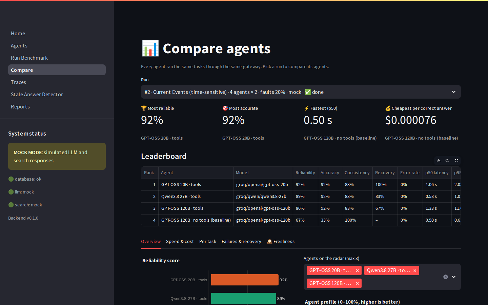

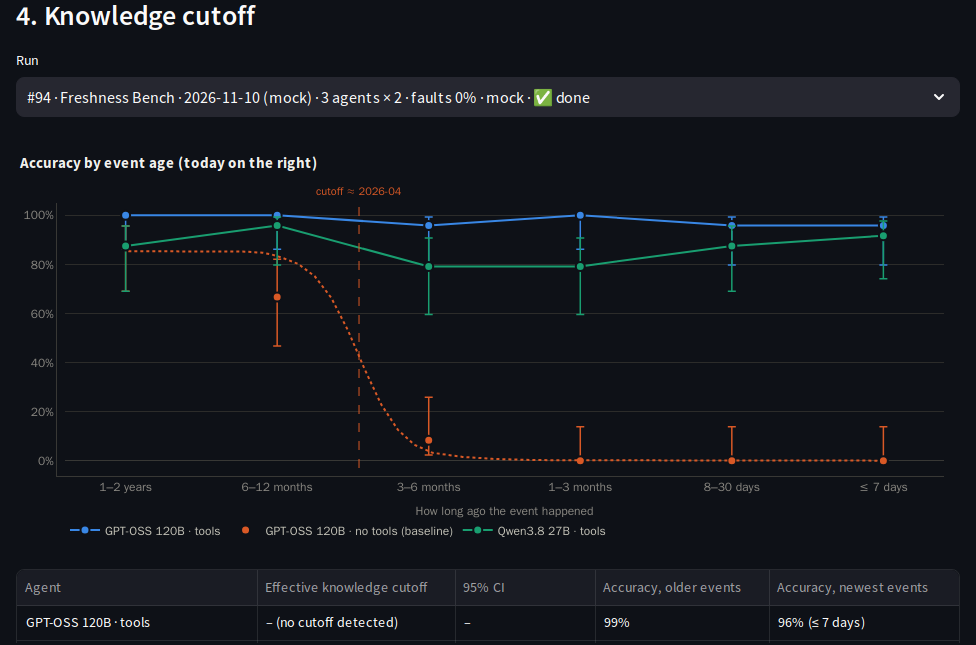

## Features

| | |
|---|---|
| **Agents** | Model + system prompt + tools (`web_search`, `calculator`, `current_date`) + step budget. Six pre-configured across Groq, OpenRouter and local Ollama. Try one on a prompt, with fault injection, and see its trace. |
| **Bring your own model** | Connect any OpenAI-compatible endpoint (Ollama, LM Studio, vLLM, llama.cpp, OpenAI, Anthropic, Gemini, Mistral…) with a base URL, model name and optional API key (encrypted, never shown again). Test chat and tool calling, then benchmark it next to the built-in models. |
| **Your own benchmarks** | Create, duplicate, import and export (YAML, CSV) suites; edit tasks in a table; test scorers on sample answers. |
| **Benchmarks** | Suite × agents × repeats × fault rate, in the background with live progress. Scorers: contains, exact, numeric, regex, LLM judge. Three built-in suites (factual QA, math & reasoning with tools, time-sensitive current events). |
| **Is the ranking real?** | 95% intervals (Wilson for accuracy, paired task-level bootstrap for reliability), rank **tiers** that say when agents are statistically tied, a power note, and a **jury** scorer (three judge models from different labs, Fleiss κ and disputed tasks). [Details](docs/statistics.md). |
| **Live Freshness Bench** | Tavily news from this week to two years ago → a model writes dated questions → a second check rejects weak ones → a read-only daily snapshot. Run agents on it and read each one's **knowledge cutoff**; a daily pulse tracks drift. [Details](docs/freshbench.md). |
| **Freshness Guard** | An OpenAI-compatible proxy: point any OpenAI SDK at AgentPulse and each answer is fact-checked, then annotated, corrected (with citations) or blocked. Guard API keys, OIDC ID tokens and scopes. [Details](docs/guard.md). |
| **Bifrost, deeper** | **Outage drills** (a chaos provider fails a share of calls; Bifrost's own fallbacks rescue them), per-call gateway overhead, and web search through Bifrost's **MCP gateway**. [Details](docs/bifrost.md). |
| **Reliability metrics** | Accuracy, consistency, pass@k, pass-all-k, error rate, **recovery rate** (failed and still correct), p50/p95 latency, tokens, list-price cost, cost per correct answer, and a composite **reliability score** with documented weights. |
| **Fault injection** | Tool timeouts, HTTP 500s, empty and malformed results; LLM retries with backoff; rate-limit-aware retries; corrective retry on rejected tool calls. |
| **Stale-answer detector** | LLM claim extraction, time-sensitivity flags (LLM + rules), a neutral Tavily query per claim, an LLM verdict against dated sources, clock checks for "today" claims, a freshness score. It runs automatically on benchmark answers to time-sensitive tasks. |
| **Dashboard** | Compare (tiles, leaderboard with intervals and tiers, reliability bars, radar, latency, accuracy-vs-cost, task heatmap, failures, freshness, knowledge cutoff, gateway), Traces (step timeline), Detector, Freshness Bench, Freshness Guard, Reports. |
| **Reports** | Markdown, CSV (leaderboard or executions) and JSON per run, with the same numbers as the dashboard. [Example from a live run](docs/examples/live-run-report.md). |
| **Mock mode** | Deterministic simulated models and search, with the *same* code paths. The whole product works offline with no keys, and demo data is pre-seeded. |

<table>
<tr>
<td>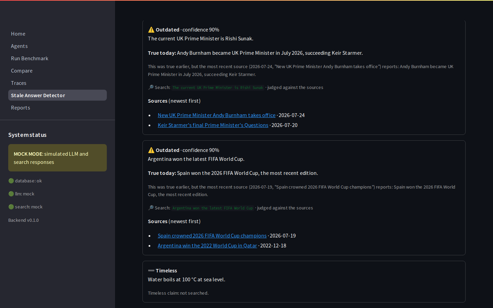</td>
<td>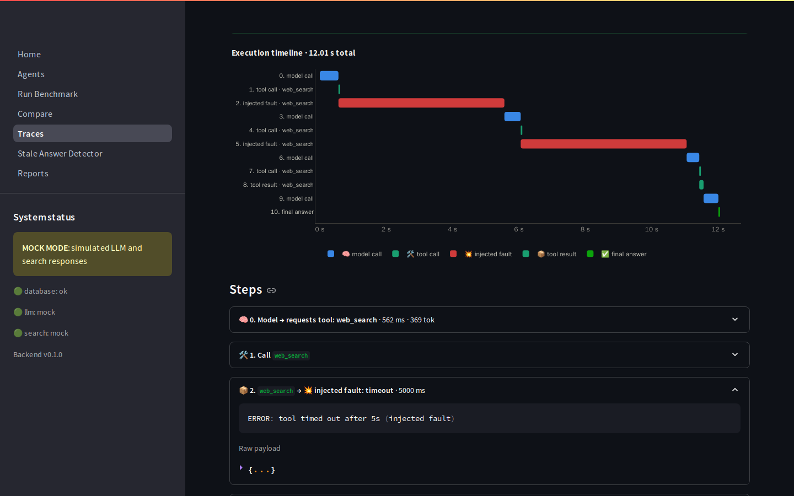</td>
</tr>
<tr>
<td>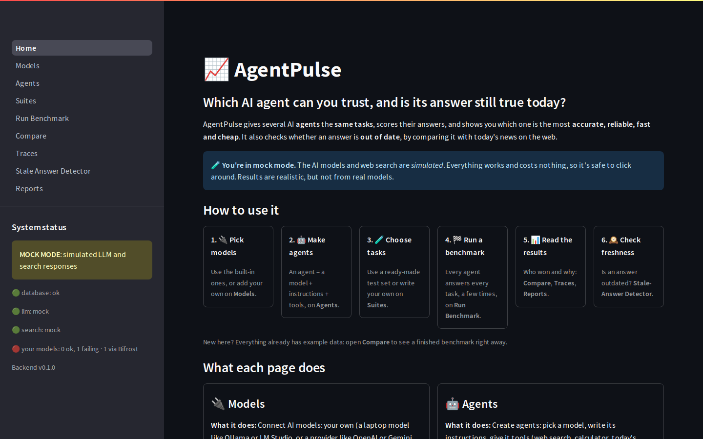</td>
<td>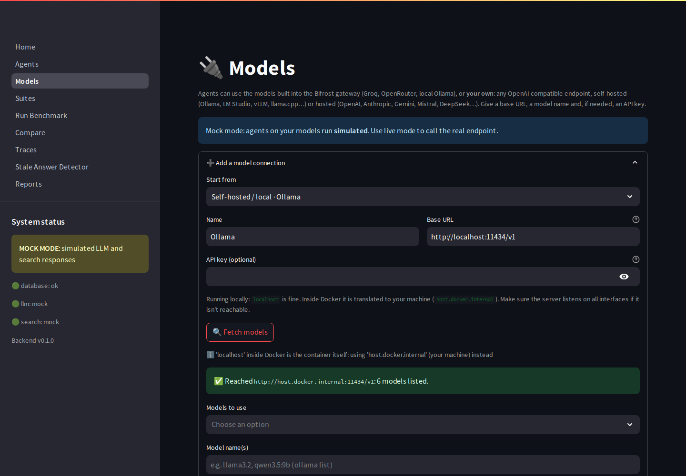</td>
</tr>
<tr>
<td>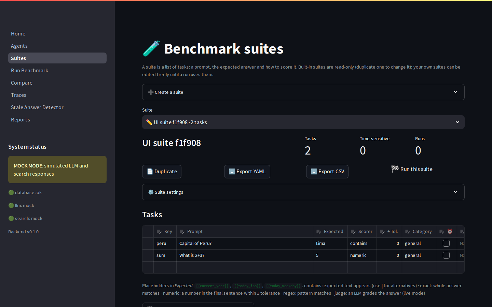</td>
<td>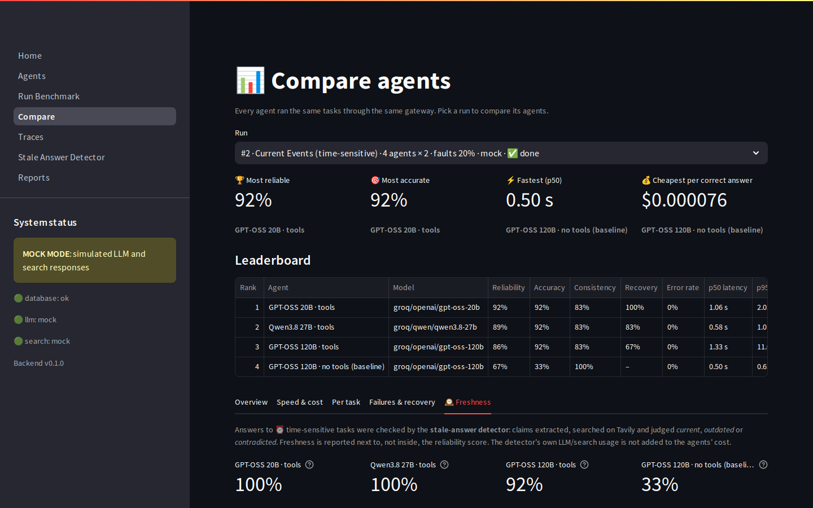</td>
</tr>
<tr>
<td>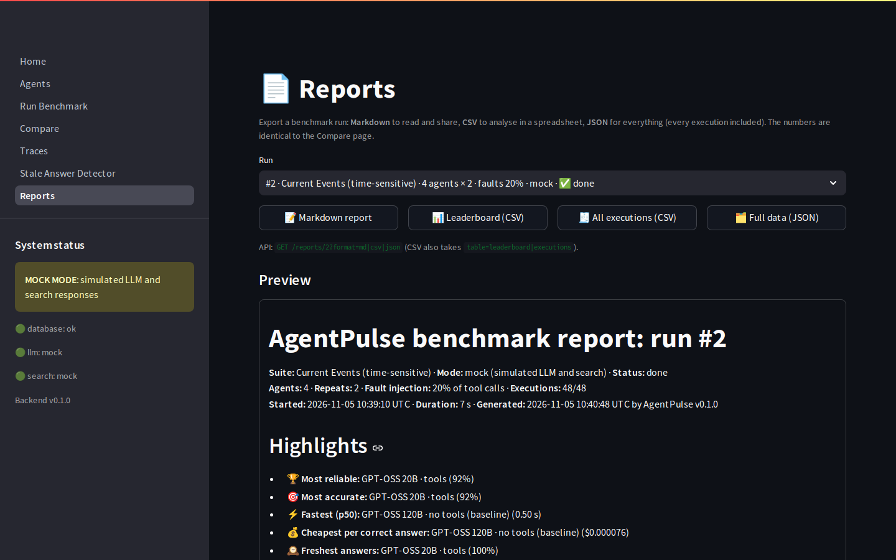</td>
<td>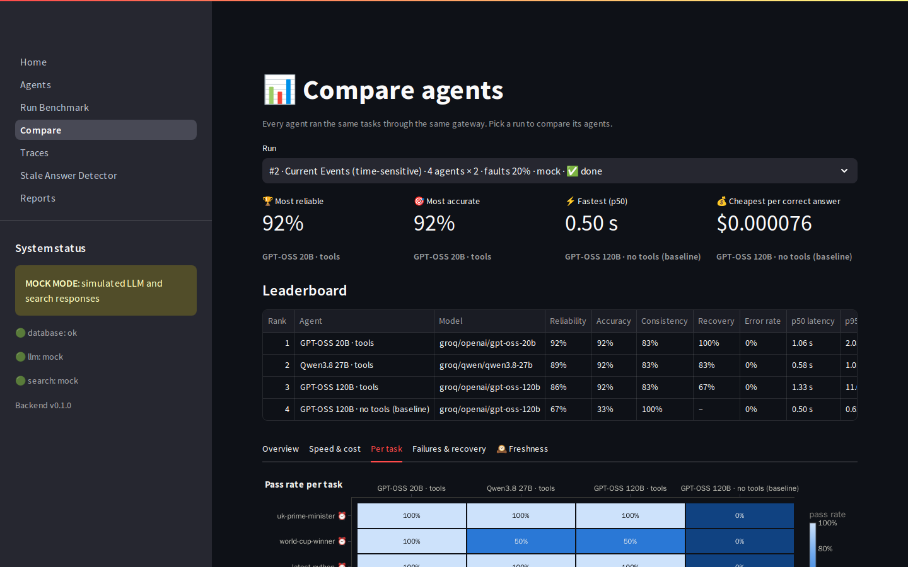</td>
</tr>
<tr>
<td>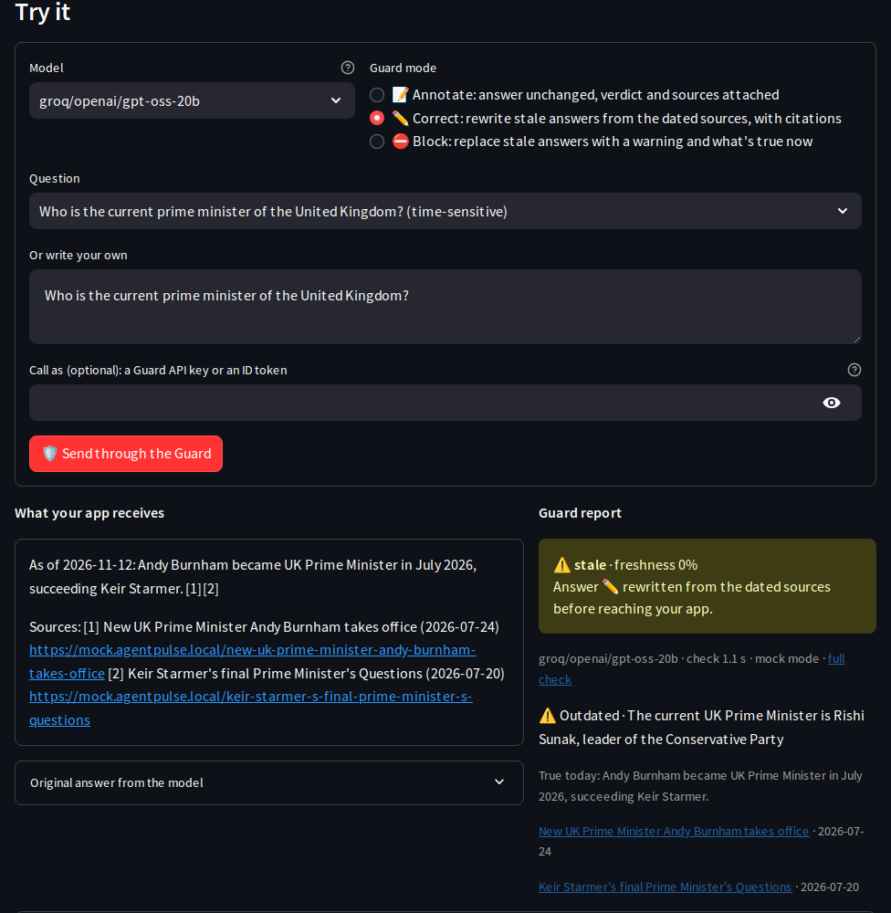</td>
<td>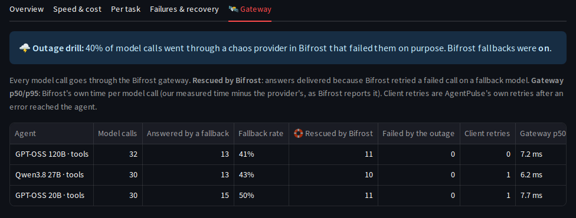</td>
</tr>
</table>

## How the hackathon challenges are used

**Bifrost: every LLM call goes through one gateway.**
- Agents, the scoring judge and the stale-answer detector all call Bifrost's OpenAI-compatible
  `/v1/chat/completions` with `provider/model` ids: `groq/…`, `openrouter/…` and `ollama/…` (local).
  Identical request paths make comparisons across providers fair.
- Provider keys live only in Bifrost's config (`env.` references). The backend never sees them.
- Costs come from Bifrost's model catalogue (`/v1/models` pricing).
- Bifrost's error kinds (rate limits, provider errors, rejected tool calls) drive the runtime's retry and
  recovery logic.
- **Fallbacks and outage drills:** a custom `chaos` provider fails a chosen share of model calls; with
  request-level `fallbacks`, Bifrost retries them on a backup model, and AgentPulse reports what the gateway
  rescued. Agents can carry their own `fallbacks` for real outages.
- **Gateway overhead:** Bifrost's reported provider latency vs our measured time, per call.
- **MCP gateway:** web search runs as a tool call on Bifrost (`/v1/mcp/tool/execute`, Tavily's MCP server), so
  model calls and tool calls share one gateway.
- Details: [docs/bifrost.md](docs/bifrost.md).

**Tavily: live search and claim verification.**
- Agents use Tavily as their `web_search` tool (through Bifrost's MCP gateway, with a REST fallback), so
  tools-vs-no-tools is measurable on time-sensitive tasks.
- The **Live Freshness Bench** uses Tavily as a *source of fresh evaluation data*: dated news by publication
  window, turned into questions that did not exist yesterday.
- The **Freshness Guard** uses the same verification on answers passing through an OpenAI-compatible proxy.
- The stale-answer detector searches Tavily for each time-sensitive claim, with a neutral query that leaves
  out the claimed answer. It judges the claim against the sources' publication dates and cites the newest.
- Benchmarks score each agent's *freshness* next to its reliability.
- Details: [docs/stale-answer-detection.md](docs/stale-answer-detection.md).

Validated live on 2026-11-05: "The current UK PM is Rishi Sunak" → outdated (Andy Burnham, July 2026), "Argentina
won the latest World Cup" → outdated (Spain, July 2026), "Python 3.13 is the newest" → outdated (3.15, October
2026), "Water boils at 100 °C" → timeless, not searched.

## Architecture

```
┌──────────────────────┐   HTTP    ┌────────────────────────────┐  OpenAI-compatible  ┌──────────────────┐
│ Streamlit dashboard  │ ────────▶ │  FastAPI backend :8000     │ ──────────────────▶ │  Bifrost gateway │
│ :8501                │           │  • agent runtime + tools   │ ◀─ chaos provider ─ │  :8080           │
│ Home · Models        │           │  • benchmark engine, stats │    (outage drills)  │  • fallbacks     │
│ Agents · Suites      │           │  • stale-answer detector   │                     │  • MCP gateway   │
│ Run · Compare        │           │  • Freshness Bench + pulse │                     └────────┬─────────┘
│ Traces · Detector    │           │  • Freshness Guard proxy   │ ◀── any OpenAI SDK    ┌──────┼──────────┐
│ Bench · Guard        │           │    (keys, ID tokens)       │     (apg_ key / JWT)  ▼      ▼          ▼
│ Reports              │           └─────┬──────────────┬───────┘                    groq/…  openrouter/… ollama/…
└──────────────────────┘                 │              │ HTTPS
                                         ▼              ▼
                                  ┌────────────┐  ┌────────────┐
                                  │ PostgreSQL │  │ Tavily API │  news windows · claim verification
                                  └────────────┘  └────────────┘  (also as MCP tool calls through Bifrost)
```

**Mock or live is decided per request.** With `MOCK_MODE=true`, requests are mock unless they carry a valid
access code, so one deployment serves a free public demo and gated live runs. Every run records the mode it ran
in. More: [docs/architecture.md](docs/architecture.md).

## Quickstart

```bash
make setup     # .venv + dev deps + .env (MOCK_MODE=true works with no keys at all)
make up        # build & start everything, wait until healthy (demo data appears within ~1 min)
make health    # check backend, Bifrost and dashboard
```

Open http://localhost:8501. Without `make`: `cp .env.example .env && docker compose up --build -d --wait`.
On Windows, `make` is available via `choco install make`.

| Service | URL |
|---|---|
| Dashboard (Streamlit) | http://localhost:8501 |
| API (FastAPI) + OpenAPI docs | http://localhost:8000/docs |
| Bifrost gateway | http://localhost:8080 |
| PostgreSQL | localhost:5432 |

### Live mode

| Key in `.env` | Used for |
|---|---|
| `GROQ_API_KEY` | Groq models via Bifrost (the default agents, and the detector's fallbacks) |
| `OPENROUTER_API_KEY` | OpenRouter models via Bifrost. The default judges, jury and detector (Claude Sonnet / Opus, Gemini, DeepSeek) are paid OpenRouter models, so keep a few dollars of credit on the key. |
| `TAVILY_API_KEY` | `web_search` tool and claim verification |
| Ollama on the host (optional) | `ollama pull granite4:3b` for the local agent |

Then run `make up-live` (or set `MOCK_MODE=false`) and `make live-check`, which should give `7/7 checks passed`.
Full setup, every setting and troubleshooting: **[docs/setup.md](docs/setup.md)**.

## Documentation

- [Pitch deck (PDF)](docs/AgentPulse-pitch-deck.pdf): 18 slides: the problem, how it works, and exactly how Bifrost and Tavily are used (covers v1 and v2; v3 is described in the docs below)
- [Demo script](docs/DEMO_SCRIPT.md): a 4–5 minute click path, pre-flight checklist and fallback plan
- [Setup & configuration](docs/setup.md): keys, Ollama, mock vs live mode, demo data, troubleshooting
- [Architecture](docs/architecture.md): components, clients, detector modules, data model
- [Bifrost integration](docs/bifrost.md): gateway config, model ids, error handling, live check
- [Agents](docs/agents.md): agent definition, default agents, tools, runtime loop, fault injection
- [Models](docs/models.md): bring your own model: connections, presets, keys, security
- [Benchmarks](docs/benchmarks.md): suites, task format, scorers, how runs execute, cost
- [Metrics](docs/metrics.md): every formula, the reliability score and freshness
- [Statistics](docs/statistics.md): confidence intervals, statistical ties, and the jury of judges
- [Freshness Guard](docs/guard.md): an OpenAI-compatible proxy that fact-checks every answer (annotate, correct or block), with API keys, ID tokens and scopes
- [Live Freshness Bench](docs/freshbench.md): a benchmark generated from today's news, and each model's knowledge cutoff
- [Stale-answer detection](docs/stale-answer-detection.md): pipeline, verdicts, freshness score, rate limits, live results
- [Dashboard](docs/dashboard.md): every page and the chart design rules
- [API reference](docs/api.md): endpoints with curl examples (full spec at http://localhost:8000/docs)
- [Example reports](docs/examples/): Markdown and CSV exported from a live run
- [Deployment](docs/deployment.md): Render auto-deploy (free Docker service), access code, secrets
- [Continuous integration](docs/ci.md): what runs on every push and how to run it locally
- [Changelog](CHANGELOG.md): what each phase built and what live testing found

## Repository layout

```
backend/app/
  agents/      runtime loop (tool calling, retries, fault injection) and tools
  bench/       benchmark engine, scoring (incl. jury), metrics, statistics, pricing
  freshness/   stale-answer detector: prompts, heuristics, checker, store
  freshbench/  Live Freshness Bench: generator, jobs, knowledge-cutoff curve, daily pulse
  guard/       Freshness Guard proxy: service, access control (keys, OIDC, scopes, rate limits)
  clients/     Bifrost (+ fallbacks, MCP search) and Tavily clients, chaos ids, and their mock twins
  routers/     agents, suites, runs, freshness, freshbench, guard, chaos, reports APIs
  seed/        default agents, task suites, demo data
  reports.py   Markdown / CSV / JSON reports
frontend/      Streamlit dashboard (Home.py, pages/, charts.py, ui.py, api.py)
bifrost/       Bifrost gateway configs (local + cloud) and schema snapshot
deploy/        single-container image for Render (Bifrost + API + dashboard)
docs/          documentation, example reports, screenshots
```

## Development

| Command | What it does |
|---|---|
| `make setup` | Create `.venv`, install dev dependencies, create `.env` |
| `make up` / `make up-live` | Start the stack in the `.env` mode / forced live mode (`MOCK_MODE=false`) |
| `make down` / `make reset` | Stop (keep data) / stop and wipe volumes |
| `make restart` | Recreate backend + frontend (after `.env` changes) |
| `make logs` / `make ps` / `make health` | Observe the stack |
| `make ollama-test` | Prompt Ollama through Bifrost (`make ollama-test OLLAMA_MODEL=qwen3.5:9b` to change model) |
| `make llm-test MODEL=<id>` / `make models` | Prompt any model through Bifrost / list reachable models |
| `make live-check` | Test real Bifrost providers, tool calling and Tavily end to end |
| `make db-tables` | List PostgreSQL tables |
| `make test` / `make lint` / `make format` | Tests / lint check / auto-fix |
| `make ui-test` | Render dashboard pages against the running stack (needs `make up`) |
| `make validate-config` | Validate both Bifrost configs against Bifrost's JSON schema |
| `make image-smoke` / `make image-live` | Build the deploy image and smoke-test it / run it locally with your keys (unlock code `letmein`) |
| `make check` | Lint + config validation + tests (what CI runs). **Run before every commit.** |

Tech: Python 3.12 · FastAPI · SQLAlchemy 2 · Streamlit · Plotly · PostgreSQL 16 (SQLite in tests and on
Render) · Bifrost (pinned by digest) · Tavily · Docker Compose · GitHub Actions · Render.
