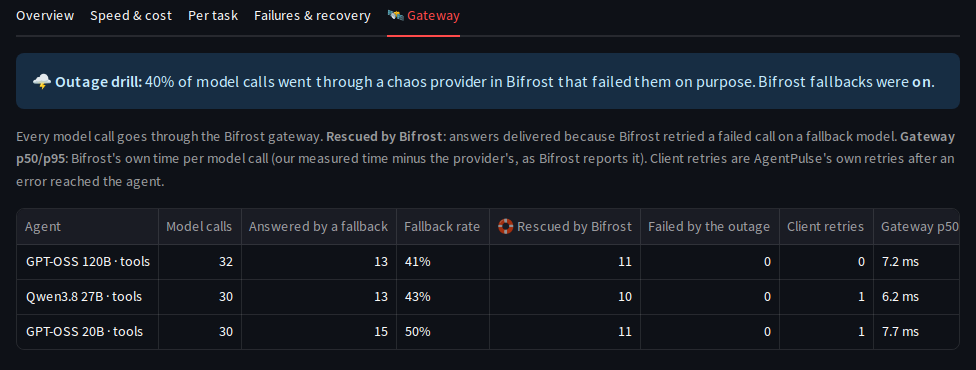

# Bifrost integration

[Bifrost](https://github.com/maximhq/bifrost) is the AI gateway between AgentPulse and every LLM.
Agents, the LLM judge and the claim extractor all call **one** OpenAI-compatible endpoint, and
Bifrost routes each request to the right provider.

```
backend ── POST /v1/chat/completions {"model": "groq/openai/gpt-oss-20b", ...} ──▶ Bifrost ──▶ Groq
                                     {"model": "openrouter/...:free", ...}                ──▶ OpenRouter
                                     {"model": "ollama/granite4:3b", ...}                 ──▶ Ollama (host)
```

Why it matters for benchmarking: every agent goes through the **identical request path**
(same client code, same gateway, same timeout), so differences in latency, tokens and errors come
from the model and agent, not from different SDKs.

## Model ids

`<provider>/<model>`, exactly as listed by `make models` (`GET /v1/models`) or by the backend's `GET /models`.

| Provider | Example | Key |
|---|---|---|
| Groq | `groq/openai/gpt-oss-20b`, `groq/qwen/qwen3.8-27b` | `GROQ_API_KEY` |
| OpenRouter | `openrouter/nvidia/nemotron-3.5-lightning:free` | `OPENROUTER_API_KEY` |
| Ollama | `ollama/granite4:3b`, `ollama/qwen3.5:9b` | none (local) |

## Configuration (`bifrost/config.json`)

The file is validated against Bifrost's JSON schema (`$schema: https://www.getbifrost.ai/schema`).
It is mounted read-only at `/app/data/config.json`, and Bifrost's runtime state lives in the `bifrost-data` volume.

| Setting | Value | Why |
|---|---|---|
| `source_of_truth` | `"config.json"` | The file always wins over state persisted in the volume, so behaviour is reproducible. |
| `client.enforce_auth_on_inference` | `false` | No virtual key needed. **Local/demo only**: enable it for shared deployments. |
| `providers.*.keys[].value` | `"env.GROQ_API_KEY"` … | Secrets come from the environment and never from the file. |
| `providers.*.keys[].models` | `["*"]` | The key may serve any model of that provider. |
| `providers.ollama.keys[].ollama_key_config.url` | `env.OLLAMA_URL` | Defaults to `http://host.docker.internal:11434`. |
| `providers.ollama.network_config.allow_private_network` | `true` | `host.docker.internal` resolves to a private IP, which Bifrost's SSRF guard blocks by default. |

### Adding a provider

1. Add a block under `providers` (see the [Bifrost provider docs](https://docs.getbifrost.ai/)) with `"value": "env.MY_KEY"`.
2. Pass `MY_KEY` to the `bifrost` service in `docker-compose.yml` and add it to `.env.example`.
3. Run `docker compose up -d --force-recreate --wait bifrost`, then `make models` to confirm.

## Runtime provider registration

Hosted [model connections](models.md) are registered in Bifrost while it runs
(`backend/app/clients/bifrost_admin.py`, `backend/app/connection_routes.py`). What we verified against the
pinned image:

| Behaviour | Result |
|---|---|
| Management API without auth | **Locked**: Bifrost requires `X-Bifrost-Setup-Token` (its `BIFROST_SETUP_TOKEN`). Missing → 401, wrong → 403. |
| `POST /api/providers {"provider": p}` | Added immediately, **no restart**. 409 if it exists. |
| `POST /api/providers/{p}/keys` | Added, and **Bifrost validates the key** (`status: success` or `list_models_failed` + `description`). `keys` is `null` for a provider without keys. |
| `DELETE /api/providers/{p}/keys/{id}`, `DELETE /api/providers/{p}` | Work immediately |
| Chat with `p/model` right after registering | Routed with the new key (`routing_info.key`) |
| Bifrost restart with `source_of_truth: "config.json"` | **Runtime additions are dropped.** AgentPulse re-registers on demand (self-healing). |
| Config store disabled (`config.cloud.json`) | Adding a provider fails: "config store not found". Hosted connections fall back to direct. |
| Config store on SQLite at 0.1 CPU (Render free) | "database is locked" errors return (4 in 3 minutes), so it stays **disabled on Render** |

Setup: compose passes the same `BIFROST_SETUP_TOKEN` (from `.env`) to Bifrost and the backend. Generate one with
`python -c "import secrets;print(secrets.token_urlsafe(24))"`. The token only works while Bifrost's dashboard
auth is off, which it is here. Keep it secret: it grants full control of the gateway (port 8080 is published on
your machine).

## Backend client (`backend/app/clients/llm.py`)

`BifrostClient` uses plain `httpx` rather than an SDK, which gives full control over:

- **Timeouts:** `LLM_TIMEOUT_S` (default 60 s), with a 10 s connect timeout.
- **Error classification** into `LLMError(retryable=...)`:

  | Condition | `kind` | retryable |
  |---|---|---|
  | Read timeout | `timeout` | ✅ |
  | Connection refused / DNS | `connection` | ✅ |
  | HTTP 429 | `rate_limited` | ✅ |
  | HTTP 5xx | `provider_error` | ✅ |
  | HTTP 4xx (bad model, bad request) | `provider_error` | ❌ |
  | Empty `choices` / non-JSON | `empty_response` / `bad_response` | ✅ |

- **Bifrost metadata:** `extra_fields.provider` is captured on each response.
- **No hidden retries:** the agent runtime (Phase 2) owns retry policy, so every retry shows up in the execution trace.

Tool calls follow the OpenAI format. Malformed tool-call arguments are kept (`{"_raw": ...}`) instead of raising an error, so that a model's broken output becomes a scored, traceable failure rather than a crash.

## Deeper use: fallbacks, overhead and the MCP gateway

Three more Bifrost features are used, each spiked against the pinned image first.

### Provider-outage drills (Bifrost's own fallbacks)



`bifrost/config.json` registers a **custom provider `chaos`** (an OpenAI-compatible provider whose base URL is
AgentPulse's own `/chaos` endpoint, `max_retries: 0`). A model id `chaos/r40/groq/openai/gpt-oss-20b` means
"call groq/openai/gpt-oss-20b, but fail 40% of the calls with a 503 first":

```
agent ─ POST /v1/chat/completions {"model": "chaos/r40/groq/…", "fallbacks": ["groq/…"]} ─▶ Bifrost
  Bifrost → chaos provider (AgentPulse /chaos, key CHAOS_TOKEN)
     40%: 503 "simulated provider outage"  ─▶ Bifrost itself retries the request on the fallback model
     60%: forwarded back through Bifrost to the real model
  response: extra_fields.routing_info {provider: "groq", is_fallback: true, primary_provider: "chaos"}
```

- **Run Benchmark → 🌩️ Provider outage drill:** a share of every agent's model calls (0–80%) goes through the
  chaos route; **Bifrost fallbacks on** passes the agent's `fallbacks` (or, if it has none, the same model via
  its real provider). Run the same suite with fallbacks on and off to see what the gateway saves.
- **Agents → Fallback models:** the same `fallbacks` list works outside drills, so Bifrost rescues an agent during
  a real provider outage or rate limit too (`fallbacks` is sent with every request).
- Your own model connections (`custom/…`) are called directly and are not drilled.
- **Only Bifrost may call `/chaos`.** It authenticates with the chaos provider's key. By default that is
  `CHAOS_TOKEN` (shared by Bifrost and the backend), and the shipped default is public, so create your own:
  **Run Benchmark → 🌩️ Provider outage drill → 🔑 Create or change the drill token** generates a strong random
  token (or accepts your own, 24+ characters). It is **stored encrypted** (like model keys), **pushed into
  Bifrost** through its management API at runtime (so it needs `BIFROST_SETUP_TOKEN`), and **re-applied
  automatically** at startup and before every live drill, because Bifrost forgets runtime keys on restart. It is
  never shown or returned by any API. If Bifrost can't be updated, nothing changes and the old token stays valid.
  *Back to CHAOS_TOKEN* undoes it. On a public deployment the access code is needed. The single-container
  cloud image has no management API, so there the token comes from `CHAOS_TOKEN` (Render generates a random one).
- **Metrics:** `llm_calls`, `fallback_calls`, `fallback_rate`, `rescued_by_gateway` (answers delivered because a
  fallback answered), `outage_failures` (answers lost to the outage). On Compare's **🛰️ Gateway** tab, and on
  traces (*"🛟 rescued by a Bifrost fallback (chaos → groq)"*).

### Gateway overhead

Bifrost reports the provider's own latency (`extra_fields.upstream_latency`). Our measured time minus that is
the **gateway's overhead** per model call, recorded on every call (trace step `gateway_ms`), per execution
(`gateway_ms`) and as `gateway_overhead_ms_p50` / `_p95` per agent. Typical overhead against Groq: about 5 ms
(a first call after a restart, or one rescued by a fallback, costs more).

### Tavily through Bifrost's MCP gateway

`bifrost/config.json` registers Tavily's hosted MCP server as an MCP client (`connection_type: http`,
`auth_type: headers`, the key as an `env.` reference, `tools_to_execute: [tavily_search, tavily_extract]`,
`allow_by_default: true`) with `disable_auto_tool_inject: true`, so no benchmark request ever gets extra tools.
With **`WEB_SEARCH_VIA=bifrost-mcp`** (default) the agents' `web_search` tool, the stale-answer detector, the
Freshness Bench and the Guard search through `POST /v1/mcp/tool/execute` (tool `tavily-tavily_search`): model
calls and tool calls share one gateway. Results carry publication dates as before.

- **Fallback to REST:** if Bifrost, the MCP client or the tool call fails, the search goes to Tavily's REST API
  and the trace says why (*"via Tavily REST ⚠️ (Bifrost MCP unavailable: …)"*). Successful calls show
  *"via 🛰️ Bifrost MCP (Tavily)"*.
- **Spike findings:** tools are named `<client>-<tool>` (`tavily-tavily_search`); the MCP tool's parameters
  differ from the REST API (no `include_answer`; `include_published_date` instead), which the client handles;
  a client needs `allow_by_default` (or a virtual key) to be callable; MCP needs Bifrost's config store.
- **The single-container cloud image** (Render) runs Bifrost without a config store (SQLite locks at 0.1 CPU), so
  there `WEB_SEARCH_VIA=rest` and the cloud config has no `mcp` block. Outage drills work there.

## Verifying

```bash
make models                                   # every routable model id
make llm-test MODEL=groq/openai/gpt-oss-20b   # one prompt
make live-check                               # health + 3 providers + tool calling + Tavily
```

Expected `make live-check` output:

```
  PASS  bifrost: health                                      http://bifrost:8080 ok
  PASS  bifrost: list models                                 groq=11, ollama=6, openrouter=493
  PASS  chat: groq/openai/gpt-oss-20b                        'pong' · 120 tok · 255 ms · groq
  PASS  chat: openrouter/nvidia/nemotron-3.5-lightning:free  'pong' · 138 tok · 2260 ms · openrouter
  PASS  chat: ollama/granite4:3b                             'pong' · 39 tok · 6056 ms · ollama
  PASS  tool calling: groq/openai/gpt-oss-20b                calculator({'expression': '17 * 23'}) · 359 ms
  PASS  tavily: news search                                  3 results, newest 2026-07-24 · 2562 ms

  7/7 checks passed
```

Test other models with `docker compose exec backend python -m app.scripts.live_check --models <id> <id> --tool-model <id>`.
