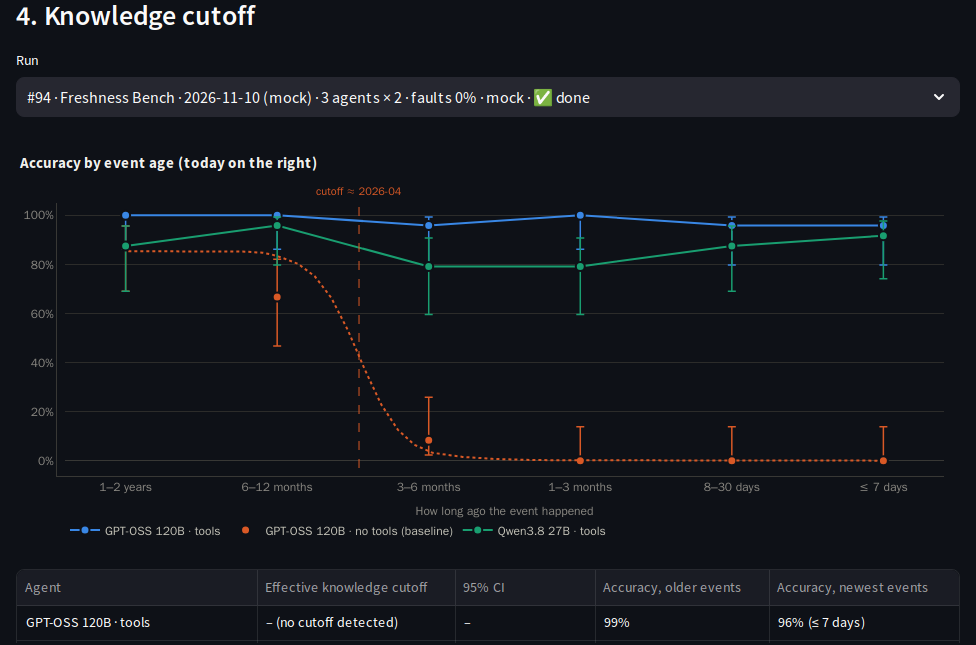

# Live Freshness Bench

A benchmark that **can't be memorised, because it didn't exist yesterday**. AgentPulse builds it from the
news with Tavily: dated questions about events from this week back to two years ago, each with its source.
Running agents on it shows how their accuracy falls for newer events, and so each model's **effective
knowledge cutoff**: the point after which it stops knowing what happened, unless it searches the web.



*Mock mode (fictional news): GPT-OSS 120B without tools stops knowing events after ~April 2026; with web search
it, and Qwen3.8 27B, stay near 100% for every age.*

Code: [`backend/app/freshbench/`](../backend/app/freshbench/). UI: the **📡 Freshness Bench** page, and the
**📡 Knowledge cutoff** tab on Compare. API: [below](#api).

## Why

Static benchmarks leak into training data and say nothing about *when* a model's knowledge ends. Model cards
state a training cutoff, but what a deployed agent actually knows depends on the data mix, the prompt and the
tools. The Freshness Bench measures it directly, on questions written the same day.

## How a snapshot is made

```
for each category (politics, sports, technology, business, science, world)
  × each event age (≤ 7 days, 8–30 days, 1–3 months, 3–6 months, 6–12 months, 1–2 years):
    1. Tavily news search with a publication window (start_date / end_date), basic depth
    2. keep dated articles inside the window, each URL once
    3. a model writes one question per article              → JSON {question, answer, aliases, event_date}
    4. a second call checks it against the article           → JSON {supported, unambiguous, guessable}
    5. local checks: answer not in the question, answer not a date, no duplicates, event inside the buckets
→ a read-only suite "Freshness Bench · YYYY-MM-DD", every task with its event date and source
```

| Step | Module |
|---|---|
| Age buckets and category queries | [`buckets.py`](../backend/app/freshbench/buckets.py) |
| Writer and validator prompts | [`prompts.py`](../backend/app/freshbench/prompts.py) |
| Search → write → validate | [`generator.py`](../backend/app/freshbench/generator.py) |
| Background jobs and snapshot storage | [`jobs.py`](../backend/app/freshbench/jobs.py) |
| Knowledge-cutoff curve | [`curve.py`](../backend/app/freshbench/curve.py) |
| Daily pulse and history | [`pulse.py`](../backend/app/freshbench/pulse.py) |

**Question rules** (writer prompt): one concrete outcome (who won, who was elected, which company bought or
launched something, where something was signed, a number); the question names the event and its month and
year; a short answer (1–5 words) with accepted aliases; no yes/no questions; the answer is not in the question
and is not a date; not guessable from general knowledge.

**Validation** rejects a question when the article doesn't state the answer, more than one answer fits, or it
could be guessed. Rejections are counted per reason and shown on the page (*"72 questions from 88 articles ·
rejected: 8 not supported, 8 ambiguous"*). Writer and validator use `FRESHNESS_MODEL` with its fallbacks
(Claude Sonnet 5.5 by default, through Bifrost).

**Snapshots are read-only**, so results stay reproducible: duplicate one to edit it (a copy keeps the event
dates). Today's snapshot is reused unless you ask for a new one. Grading is `contains` with the aliases by
default (word-boundary matching); `judge` or `jury` can be chosen.

## The knowledge-cutoff curve

For a run of a suite with dated questions, every agent gets accuracy per age bucket (95% Wilson intervals) and
a fit of

```
p(age) = plateau / (1 + exp(-(age − m) / s))
```

- `plateau`: accuracy on events clearly older than the cutoff (first guess: the oldest third of the
  questions; then those older than `m + 3s`, and the fit is redone);
- `m`: the event age at which accuracy is half the plateau, so the **effective knowledge cutoff** is `m` days
  before the snapshot;
- `m` and `s` come from a grid search on the binomial log-likelihood over individual answers; the interval is
  a seeded task-level bootstrap (150 resamples, plateau held at its estimate).

| Result | Meaning |
|---|---|
| **estimated** (e.g. *2026-04, 95% CI 2026-03 – 2026-05*) | accuracy drops for newer events: the model answers from training data |
| **no cutoff detected** | it knows the newest events about as well as old ones, usually because it searched the web |
| **too little signal** | it rarely answers even old events correctly (plateau < 25%) |
| **too few questions** | fewer than 6 dated questions |

Run **the same model with and without web search** to separate *knows it* from *can look it up*. Provider
errors are left out of the curve: they say nothing about what the model knows.

On synthetic data with known cutoffs of 60, 210 and 400 days, the fit recovers 50, 200 and 410 days, each inside
its interval (`backend/tests/test_freshbench.py`).

## Over time: the pulse

`FRESHBENCH_PULSE_HOUR_UTC` turns on a scheduler. Every day after that hour, AgentPulse generates the day's
snapshot (if it doesn't exist) and runs it on `FRESHBENCH_PULSE_AGENTS`. The page then charts each agent's
accuracy per snapshot and raises a **drift alert** when the newest run is more than `FRESHBENCH_DRIFT_POINTS`
below the agent's previous ones (for example after a provider silently swaps a model).

## Mock mode

The offline demo uses a **fictional** news corpus ([`clients/mock_news.py`](../backend/app/clients/mock_news.py)):
invented teams, companies, people and places, dated relative to today so it never goes stale, with a few
deliberately flawed items that the mock validator rejects. Mock models have knowledge cutoffs (GPT-OSS 120B 210
days, GPT-OSS 20B 260, Qwen3.8 27B 140, Nemotron 110, Granite 430) with a smooth ramp, and agents that search
find the article. So the mock curve looks like a real one: the no-tools agent drops at its cutoff, the tools
agent stays flat.

## Cost

| | Live |
|---|---|
| Tavily | 1 basic search per category × age cell: 36 credits for the full bench |
| Models | about 2 calls per article plus a few skips: ~150 calls for the full bench (Claude Sonnet 5.5 by default, falling back to Groq) |
| Time | ~1 minute for 12 cells; a few minutes for the full bench |
| Running it | one execution per question × agent × repeat; agents with web search also spend Tavily credits |

Choose fewer categories, ages or questions per cell on the page to spend less. Mock generation is free.

## Settings

| Variable | Default | Purpose |
|---|---|---|
| `FRESHBENCH_PER_CELL` | `2` | Questions per category × age bucket |
| `FRESHBENCH_PULSE_HOUR_UTC` | unset (off) | Generate and run the bench every day after this UTC hour |
| `FRESHBENCH_PULSE_AGENTS` | `2,4` | Agent ids the pulse runs (GPT-OSS 120B with and without tools) |
| `FRESHBENCH_DRIFT_POINTS` | `10` | Drift alert threshold (accuracy points) |

## API

| Method | Path | Description |
|---|---|---|
| GET | `/freshbench/config` | Categories, age buckets, defaults and pulse status |
| POST | `/freshbench/generate` | Start a generation job → `202 {job}`, or `{existing_suite_id}` when today's snapshot exists. Body: `categories`, `buckets`, `per_cell` (1–5), `scorer` (`contains` · `judge` · `jury`), `force`. Live with the access code; `force` in mock mode needs it on the public demo. `409` while a job runs. |
| GET | `/freshbench/jobs` · `/freshbench/jobs/{id}` | Job status, progress, result summary (kept in memory) |
| GET | `/freshbench/snapshots` | Snapshots with questions per age bucket and run counts |
| GET | `/freshbench/history` | Accuracy per agent per Freshness Bench run, drift alerts, pulse state |
| GET | `/runs/{id}/knowledge-curve` | The curve for one run (also in `GET /runs/{id}/metrics` as `knowledge_curve`) |

```bash
curl -s localhost:8000/freshbench/generate -H 'content-type: application/json' \
  -d '{"categories": ["sports", "technology"], "per_cell": 1}'
curl -s localhost:8000/freshbench/jobs/1
curl -s localhost:8000/runs -H 'content-type: application/json' \
  -d '{"suite_id": 12, "agent_ids": [2, 4], "repeats": 1, "check_freshness": false}'
curl -s localhost:8000/runs/80/knowledge-curve
```

## Validated live (2026-11-10)

A 12-question bench (sports and technology × 6 ages, 1 per cell): 12 Tavily searches, 73 s, 14 articles, 2
rejected (no clear fact; answer in the question). Questions such as *"Who won the 2026 Simmons Bank
Championship in November 2026?"* (Darren Fichardt) and *"Who won the 2026 Tour Championship in August 2026?"*
(Scottie Scheffler).

| Agent | Newest events | 1–2 years old | Result |
|---|---|---|---|
| GPT-OSS 120B · tools | 100% | 100% | no cutoff detected: it found Fichardt, Tulsa, DexCom's $0.73 EPS, Scheffler |
| GPT-OSS 120B · no tools | 0% ("I don't have information on…") | 50% | cutoff ≈ 2025-08 (95% CI 2025-05 – 2026-01) |

With 12 questions the interval is wide; the full bench (72) narrows it. The live run also surfaced two fixes:
answers that are just a date are now rejected, and `contains` no longer misses names followed by `™` or `®`.

## Limitations

- Questions come from what Tavily's news index returns for each window: coverage leans toward English-language,
  widely reported events.
- A question is only as good as its article; validation is strict but model-based. Every question links its
  source, so a disputed one can be checked (and a copy of the snapshot edited).
- Very recent events (≤ 7 days) are few per category; the curve's newest point has the widest interval.
- The cutoff is an *effective* one for this agent setup (model + prompt + tools), not the provider's
  training-data date.
