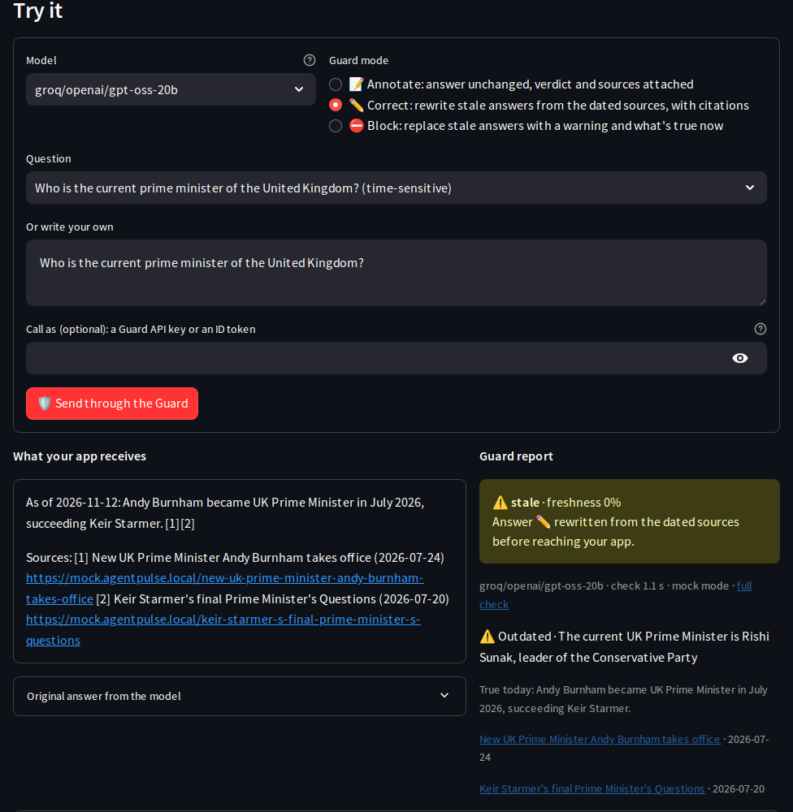

# Freshness Guard

An **OpenAI-compatible proxy that fact-checks answers before your users see them**. Put AgentPulse between an
app and its model: it forwards each chat request (through Bifrost, or your own model connection), checks the
answer's time-sensitive facts against live Tavily sources, and **annotates**, **corrects** or **blocks** it.
Any OpenAI SDK, LangChain app or chat UI can use it by changing one setting: the base URL.



Code: [`backend/app/guard/service.py`](../backend/app/guard/service.py),
[`backend/app/routers/guard.py`](../backend/app/routers/guard.py). UI: the **🛡️ Freshness Guard** page. Demo:
[`scripts/guard_demo.py`](../scripts/guard_demo.py).

## Quickstart

```python
from openai import OpenAI

client = OpenAI(base_url="http://localhost:8000/guard/v1", api_key="not-needed")
resp = client.chat.completions.create(
    model="groq/openai/gpt-oss-20b",                     # any model AgentPulse can route
    messages=[{"role": "user", "content": "Who is the UK prime minister?"}],
    extra_headers={"X-AgentPulse-Guard": "correct"},     # annotate | correct | block | off
)
print(resp.choices[0].message.content)
print(resp.model_extra["agentpulse"]["verdict"])        # fresh | stale | wrong | unverified | ...
```

```bash
pip install openai && python scripts/guard_demo.py      # all three modes on one question
curl -s localhost:8000/guard/v1/chat/completions -H 'content-type: application/json' \
  -H 'X-AgentPulse-Guard: block' \
  -d '{"model": "groq/openai/gpt-oss-20b", "messages": [{"role": "user", "content": "Who won the latest World Cup?"}]}'
```

LangChain: `ChatOpenAI(base_url="http://localhost:8000/guard/v1", api_key="not-needed", model="groq/openai/gpt-oss-20b")`.

## What happens to a request

```
your app ──POST /guard/v1/chat/completions──▶ AgentPulse
  1. forward to the model (Bifrost, or a model connection: custom/<slug>/<model>)
  2. tool call or no text?                      → pass through (not checked)
  3. no time-sensitive signal in the question
     or the answer (a poem, a definition)?      → pass through (not checked, ~0 overhead)
  4. stale-answer detector: claims → Tavily search per claim → verdict against dated sources
  5. mode: annotate / correct / block           → OpenAI response + "agentpulse" report + X-AgentPulse-* headers
  6. the check is saved (source "guard"): Guard page, Stale-Answer Detector, GET /guard/stats
```

| Mode | When the answer is stale or wrong |
|---|---|
| `annotate` (default) | Unchanged; the report says what's outdated and what's true today |
| `correct` | Rewritten from the dated sources with inline citations [1] and a *Sources* list (by `FRESHNESS_MODEL`); if no model can rewrite it, the original plus a dated correction note |
| `block` | Replaced by a warning listing each outdated claim, what's true now and a dated source |
| `off` | Plain proxy, no check |

Choose the mode with the header `X-AgentPulse-Guard` or a `guard` field in the request body. Fresh,
unverifiable and timeless answers are never changed.

## Response

A standard `chat.completion` (or `chat.completion.chunk` stream) plus:

```json
"agentpulse": {
  "guard_mode": "correct", "checked": true, "verdict": "stale", "freshness_score": 0.0,
  "action": "corrected", "check_id": 412, "check_latency_ms": 3810.4, "mode": "live",
  "original": "The current Prime Minister of the United Kingdom is Rishi Sunak.",
  "correction": "rewritten by a model from the dated sources",
  "claims": [{"text": "…Rishi Sunak.", "verdict": "outdated", "confidence": 0.98,
              "true_today": "Andy Burnham is the current Prime Minister…",
              "sources": [{"title": "…", "url": "https://…", "published_date": "2026-07-20"}]}]
}
```

Headers: `X-AgentPulse-Guard`, `X-AgentPulse-Action` (`annotated` · `corrected` · `blocked` · `skipped` ·
`none`), `X-AgentPulse-Verdict`, `X-AgentPulse-Freshness`, `X-AgentPulse-Check-Id`, `X-AgentPulse-Mode`.
With the OpenAI SDK the report is `resp.model_extra["agentpulse"]`; with streaming it arrives in the last
chunk.

**Streaming** (`stream: true`) is supported: the checked answer is buffered, then sent as OpenAI chunks, so it
is compatible, not faster. **Tools** are forwarded; tool-call replies pass through unchecked. `n` must be 1.
`GET /guard/v1/models` lists the models (OpenAI format). Errors use OpenAI's shape
(`{"error": {"message", "type", "code"}}`) with 400 / 401 / 429 / 502 / 504.

## Access control: keys, ID tokens, scopes

Every call carries a credential as `Authorization: Bearer …` (an OpenAI SDK's `api_key`). Three kinds are
accepted, and each resolves to a **caller** with **scopes** and a **rate limit**:

| Credential | How it is checked | Scopes from |
|---|---|---|
| **Guard API key** `apg_…` | Issued by an admin (`POST /guard/keys`, or the Guard page). The secret is shown **once** and only its SHA-256 hash is stored. Keys expire (default 90 days), can be revoked, and have their own requests-per-minute limit. | Chosen at issue time |
| **OIDC ID token** (JWT) | Signature verified against the identity provider's JWKS (discovered from `<issuer>/.well-known/openid-configuration`, cached, refreshed for an unknown `kid`), plus `iss`, `aud`, `exp`, `iat` (60 s leeway). Only asymmetric algorithms (RS/PS/ES/EdDSA) are accepted, so `alg: none` and HMAC key-confusion tokens are refused. | A claim (`GUARD_OIDC_SCOPES_CLAIM`, default `scope`: a space-separated string or a list such as `roles`); `guard:annotate` when it names none |
| **Access code** (`LIVE_ACCESS_CODE`, as bearer or `X-Access-Code`) | Constant-time comparison | All scopes (admin) |

| Scope | Allows |
|---|---|
| `guard:annotate` · `guard:correct` · `guard:block` | The matching mode |
| `guard:off` | Plain proxy without a check |
| `guard:live` | Real models on a public deployment (otherwise mock) |
| `guard:stats` | `GET /guard/stats` |

```bash
# admin issues a key for a partner (the access code is needed to manage keys whenever one is configured)
curl -s localhost:8000/guard/keys -H 'X-Access-Code: <code>' -H 'content-type: application/json'   -d '{"name": "support-bot", "scopes": ["guard:annotate", "guard:correct"], "expires_in_days": 90, "rpm": 30}'
# → {"id": 3, "key": "apg_…", "note": "Store this key now: it is not shown again.", …}
curl -s localhost:8000/guard/whoami -H 'Authorization: Bearer apg_…'    # who am I, what may I do
curl -s -X DELETE localhost:8000/guard/keys/3 -H 'X-Access-Code: <code>'   # revoke
```

**Policy.** `GUARD_AUTH=open` (default) lets anonymous callers use the Guard (annotate, correct, block, off,
stats; mock mode on a public deployment) but still verifies any credential that is presented and enforces its
scopes. `GUARD_AUTH=required` refuses calls without a valid credential. Anonymous callers share a per-minute
limit (`GUARD_ANONYMOUS_RPM`); every credential has its own.

| Failure | Response |
|---|---|
| No / unknown / revoked / expired credential, bad signature, wrong audience or issuer | `401` with `WWW-Authenticate: Bearer realm="agentpulse-guard", error="invalid_token"` |
| Valid credential without the needed scope | `403` with `WWW-Authenticate: … error="insufficient_scope", scope="guard:block"` |
| Rate limit reached | `429` with `Retry-After` |

All errors use OpenAI's shape (`{"error": {"message", "type", "code"}}`), so SDKs raise their usual exceptions
(`AuthenticationError`, `PermissionDeniedError`, `RateLimitError`).

**Enabling ID tokens.** Set `GUARD_OIDC_ISSUER` (e.g. `https://accounts.google.com` or your Entra / Okta /
Auth0 tenant) and `GUARD_OIDC_AUDIENCE` (your app's client id). Calls then accept that provider's ID tokens;
the caller is recorded as `oidc:<email or sub>`. Map roles to scopes by putting `guard:*` names in the claim
named by `GUARD_OIDC_SCOPES_CLAIM`.

**What is recorded.** Every checked call saves `caller` (`key:<name>`, `oidc:<user>`, `admin`, `anonymous`)
with the check, shown on the Guard page. Secrets are never stored or logged: keys only as hashes, ID tokens not
at all, and the caller's credential is never forwarded to the model provider.

**Modes without a credential.**

| Deployment | Anonymous caller |
|---|---|
| Local, `MOCK_MODE=false` | Allowed, live models (it is your machine) |
| Local, `MOCK_MODE=true` | Allowed, mock |
| Public demo (`MOCK_MODE=true` + `LIVE_ACCESS_CODE`) | Allowed, mock; a wrong code is a `401`; live needs the access code or a key with `guard:live` |

On the hosted demo only the dashboard port is public, so the Guard is tried on its page; run AgentPulse
yourself (`make up`) to call it from code.

## Cost and latency

Only answers with a time-sensitive signal are checked. A check costs one Tavily search per time-sensitive claim
(`FRESHNESS_SEARCH_DEPTH`: advanced = 2 credits) and 2–3 model calls (`FRESHNESS_MODEL`, Claude Sonnet 5.5 by
default, with Groq fallbacks); `correct` adds one more call. Expect a few seconds on top of the model's own
time; timeless answers add ~0.

## Validated live (2026-11-10)

`scripts/guard_demo.py` with the OpenAI SDK, `groq/openai/gpt-oss-20b`, "Who is the current prime minister of the
United Kingdom?":

| Mode | Time | What the app received |
|---|---|---|
| annotate | 8.5 s | "…is Rishi Sunak." with `verdict: stale` (headers `stale` / `0.00`) |
| correct | 4.3 s | "The current Prime Minister of the United Kingdom is Andy Burnham [1][2][3]." with sources (Council on Foreign Relations, 20 July 2026, …) |
| block | 3.2 s | the warning: outdated, true today Andy Burnham, with a dated source |
| a poem | 0.6 s | passed straight through (`nothing time-sensitive`) |
| stream | – | 4 chunks, verdict in the last one |

## Limitations

- The check covers time-sensitive facts (office holders, champions, latest versions, prices, counts, today's
  date), not reasoning or opinions.
- The fast path is rule-based: an answer with no temporal signal at all is not checked.
- One question per request is assumed for context (the newest user message).
